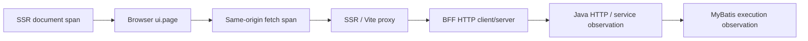

# OSS Web performance and tracing

This is the code-coupled contract for OSS home/menu/list performance instrumentation. For current production-build measurements and limits, see the [production evidence report](2026-10-15-oss-production-performance-results.md). The [first-round report](2026-10-15-oss-performance-results.md) records historical development-mode measurements. User deployment guides remain on the documentation site.

## Request path and trace ownership



The development path includes the Vite HTTP proxy. In the local production measurement mode, a loopback ingress forwards to the existing deployment BFF, which serves the compiled client and SSR handler; the document spans therefore use `auraboot-bff`, and the captured chain has three services. Server-side application reads can also reach Java directly through the existing HTTP client configuration; their parent context is propagated by Undici instrumentation. Service names are `auraboot-web`, `auraboot-ssr`, `auraboot-bff` and `auraboot-platform`.

- `web-admin/instrumentation.server.mjs` loads before the server HTTP/fetch modules, using Node's `--import`. The SDK starts by default, with or without an OTLP endpoint. `dev`, `dev:test`, `dev:web`, `dev:bff`, `start` and the production Docker command include this preloader. Builtin HTTP hooks are activated before ESM entrypoints load, preserving incoming W3C context.
- The root loader injects the active W3C `traceparent` into a document meta tag. The browser SDK starts by default and uses it as the parent of `ui.page`. React Router `.data` fetches open a `ui.navigation` span; same-origin `/api/` and `.data` fetches inject trace headers. Third-party requests are left untouched.
- Java keeps the existing W3C propagation and response `X-Trace-Id` contract. `SqlObservationInterceptor` opens `mybatis.execution` within the active observation scope for MyBatis executor query/update calls.
- `ui.page` ends at window load. It is **not** a business-data-ready metric. The home driver installs a browser-side MutationObserver before navigation and timestamps visible structure, empty inbox, shortcut rows and numeric statistics on an animation frame. Its readiness time is independent of when Playwright reads the mark. It separately checks successful critical API payloads. This controlled DOM-ready marker is not LCP, a paint timestamp, or readiness for every possible widget configuration.
- MyBatis spans contain mapper identity, operation and database system. SQL text, bind values and raw driver exception messages are not recorded by this interceptor. Its fixed failure diagnostic does not replace the exception returned to application code. SQL observation is not JDBC-wide coverage.

## Default tracing and optional remote export

| Variable | Purpose |
| --- | --- |
| `OTEL_EXPORTER_OTLP_TRACES_ENDPOINT` | Full OTLP HTTP trace URL, e.g. `http://127.0.0.1:4318/v1/traces`; adds Node remote export and configures the Java exporter |
| `MANAGEMENT_TRACING_ENABLED=true` | Java tracing defaults to true in every runtime profile; false is an explicit override |
| `MANAGEMENT_TRACING_SAMPLING_PROBABILITY` | Java root sampling, default `1`; explicitly lower it when accepting incomplete trace coverage |
| `OTEL_TRACES_SAMPLER=parentbased_traceidratio` | Explicit Node root sampler; SDK honors incoming sampled parents |
| `OTEL_TRACES_SAMPLER_ARG=0.1` | Node root ratio; **set this with the sampler** for bounded routine collection (Node SDK's own default is broader) |
| `VITE_OTEL_EXPORTER_OTLP_TRACES_ENDPOINT` | Browser exporter URL, exposed to the browser; must be browser-reachable and allow the exact Web origin with CORS |
| `VITE_OTEL_TRACES_SAMPLE_RATE` | Browser root ratio, default `1`; server parent sampling is honored |

`VITE_*` variables are build-time settings for production. Node and Java settings are runtime settings. No browser endpoint means context propagation remains enabled, while browser span export is omitted. Node and Java retain local server spans without requiring a collector; an external collector is optional. Java automatically enables remote export when either the standard OTEL endpoint or Spring OTLP endpoint is configured; otherwise the remote exporter is disabled, preserving local tracing without connection-refused noise. An explicit `management.otlp.tracing.export.enabled` override takes precedence. Do not put collector credentials into `VITE_*` variables. Protect and operate the collector as deployment infrastructure. No third-party collector SaaS is required.

Node and Java write a private JSONL trace index under `AURA_TRACE_LOG_DIR` (default `./logs/traces`), capped at five 10 MiB files per service. Only span identity, parentage, timing, status and whitelisted diagnostic attributes are retained; request bodies, headers, SQL text and automatic instrumentation exception messages are omitted. Pre-sanitized loader exceptions retain their type, message and stack in the local index as well as the original loader log. Local export failure is reported and does not fail a business request. `OTEL_SDK_DISABLED=true` explicitly disables the Node SDK.

The shipped Compose templates enable Java tracing by default and retain backend traces in the existing backend data volume and frontend traces in a dedicated named volume. Replacing containers preserves those volumes; deleting volumes deletes retained evidence. Product-managed local runtimes place both services' trace files under their own evidence directory. Search `traceId` in the JSONL files and then use `request.id` and the loader logs for the original exception.

For a complete sampled diagnostic run, set Java and browser ratios to `1` and Node `OTEL_TRACES_SAMPLER=always_on` before invoking the product launcher. All three settings must match the recorded measurement conditions. Resume state preserves the whitelisted telemetry variables and Redis host; changing a retained source or dependency still fails identity validation.

The SDK integrations follow the upstream [browser setup](https://opentelemetry.io/docs/languages/js/getting-started/browser/) and [OTLP exporter documentation](https://opentelemetry.io/docs/languages/js/exporters/). A native collector with a [file exporter](https://github.com/open-telemetry/opentelemetry-collector-contrib/blob/main/exporter/fileexporter/README.md) is sufficient for local evidence.

## Performance behavior

- Root shell branding/bootstrap/access-policy/token reads start concurrently. Every request still resolves fresh server identity and permissions.
- Parent/child entry loaders share the `/api/auth/me` in-flight promise through the **per-request React Router context**, including cloned `Request` objects. Separate HTTP requests never share this memo; a failed promise is cleared. No global auth cache or new authorization TTL is introduced.
- `/home` fetches the workbench configuration in its route loader and renders it from loader data. The initial browser mount no longer fetches the same configuration. Widget data still uses the existing real APIs; retry remains available on configuration failure.
- Field permission evaluation resolves role codes only if model fields declare field permissions, and resolves role records in one batch. Restricted fields use the existing evaluator. Models without declarations retain the existing unrestricted policy.
- Subject permission batches without any declarations return the existing visible result without loading effective grants. Batches containing declarations still resolve permissions; this does not imply all real menus use fewer queries.
- JWT subjects are stable user PIDs. The filter calls `UnifiedUserDetailsService.loadUserByPid` once per request instead of trying email, username and PID and then reading the user again. That fresh snapshot includes enabled state and security version; session validity is still checked independently. Login alias resolution retains its existing behavior. No cross-request user cache is added.
- Existing tenant and invalidation boundaries stay in place. No dynamic CRUD result cache, negative permission TTL extension or pagination/count change is introduced.

## Redis and cache boundaries

Redis is optional for this single-node OSS slice. `scripts/oss-golden-stack.sh up <name> --no-redis ...` explicitly supplies an empty Redis host, which disables the existing conditional Redis integrations. Retained resume keeps that choice. This does not switch an explicitly Redis-backed MQ/event/IM deployment into an in-memory distributed system.

The existing default Caffeine manager bounds each cache at 10,000 entries with 30-minute expiry and recorded statistics; the dedicated permission manager has its own shorter policy. Redis is appropriate only when a deployment deliberately needs its shared transport/cache semantics. Adding it does not remove repeated SQL or replace query-plan analysis. Multi-node invalidation consistency is a separate deployment acceptance requirement, not proven by the no-Redis single-node run.

### Active and passive invalidation

| Data | Key / lifetime | Active mechanism | Passive mechanism and limits |
| --- | --- | --- | --- |
| JWT user security state | PID; one fresh database snapshot per request | Next request rereads enabled state/security version; session revocation remains a separate database check | No cross-request TTL or stale-user window is introduced |
| Effective permissions and role/catalog snapshots | Tenant + user/member or role; effective date where applicable | Existing `PermissionCacheEvictionListener` runs after transaction commit for permission-definition, role-grant and membership events, evicts dependent snapshots and bumps the data-access epoch. Rollback does not deliver the after-commit eviction | Caffeine expiry after write: 5 minutes, 5,000 entries per region. Negative results also expire. A TTL bounds a lost event; it is not a substitute for prompt revocation |
| Assembled model definitions | Tenant context + model code; current-version projection | Existing model/field mutation paths evict through the separate `MetaDefinitionCacheService` bean; this avoids self-invocation bypass. Version rollback, save, delete and field-version changes are covered by real-database tests | Caffeine expiry after write: 30 minutes, 10,000 entries per region. This round does not establish metadata rollback/concurrent-repopulation consistency or distributed publication consistency |
| Command definitions and binding projections | Existing command/model cache keys | Existing mutation/publish paths evict command/binding projections; tested with the real database | Default bounded 30-minute manager; not a cache of CRUD results |
| Dynamic list rows/count and row filters | Current request, tenant and live policy | Evaluated on the request path; count reuses that request's row/domain filter | No whole-page cache or row-filter TTL is added |

Expiry is measured from the last write, not extended by every hit. Cache-loader failures propagate; they must not become an allow decision. Repeated misses share the existing Caffeine loader. Concurrent miss collapse is tested, but commit-versus-in-flight-load races across every metadata writer are not proven here.

These event listeners and Caffeine caches are process-local. A multi-node deployment needs an explicit cross-node invalidation transport or version contract and its own revoke/publication tests. Merely enabling Redis does not connect these listeners to every process. Redis remains optional for the verified single-node path.

A page-key list request can still query a missing exact model code before resolving its page schema. The missing `Optional` is not retained as a positive assembled definition. Page schema, category enrichment, contributions and environment reads are separate from the assembled-model cache. Do not add a long-lived negative page/model cache or cache the final composed page without covering create/publish/contribution invalidation and tenant/release identity.

Use authenticated operational metrics for `cache.gets`, `cache.size`, `cache.evictions`, `hikaricp.connections.*`, `http.server.requests` and `mybatis.execution`. Response `X-SQL-Count` counts instrumented synchronous MyBatis executor calls on the request path, not every physical PostgreSQL statement, JdbcTemplate operation or asynchronous database write.

## Reproduce measurements

Start an isolated host-first product stack with the `demo` plugin profile. For production measurements, supply a private file containing a strong session key (at least 32 bytes), then run:

```bash
SESSION_SECRET_FILE="$PRIVATE_SESSION_KEY_FILE" \
  scripts/oss-golden-stack.sh up "$RUNTIME" --slot "$SLOT" \
  --web-mode production --no-redis --plugin-profile demo \
  --workspace-source-root "$FROZEN_WORKSPACE_SOURCE"
```

The launcher builds both client and SSR, uses `NODE_ENV=production`, and refuses missing compiled SSR or a missing/short private session key. It uses the existing `dev:bff` script as a TypeScript process entry, without a watcher or Vite development server, matching the deployment BFF. The local ingress only preserves the runtime's three-listener contract. Resume binds the complete frontend build fingerprint, mode and private-key input fingerprint. Launcher `env` passes the same session key to canonical signed-cookie fixtures without printing the key. This local HTTP fixture does not verify deployed TLS or secure-cookie transport.

Warm it with canonical setup/auth, verify its source/artifact/process identity, and set `PERF_API_BASE`, `PERF_OUTPUT`, `AURABOOT_PASSWORD`. Then use the existing drivers:

```bash
node scripts/performance/seed-api.mjs
node scripts/performance/measure-api.mjs
node scripts/performance/measure-crud.mjs

# Also set PERF_SOURCE_ROOT, PERF_WEB_BASE and an absolute PERF_OUTPUT JSON path.
node scripts/performance/measure-home.mjs

# In web-admin, after evaluating the exact runtime's launcher env:
PERF_EVIDENCE_DIR="$EVIDENCE_DIR" PW_PROFILE=oss PW_WORKERS=1 \
  pnpm exec playwright test -c playwright.oss.config.ts \
  tests/e2e/showcase/oss-performance.spec.ts --project=oss --no-deps --workers=1
```

Use an empty showcase model for seed: the driver refuses to overwrite existing data and creates exactly 1,000 controlled records. Reads require exactly 1,000 total/20 page rows and an SQL-count header. The CRUD driver creates, edits, reads back and deletes its own records, and requires a 404 after deletion. Failures stop the run; no partial file marked `running` is a completed result.

The home driver requires an empty inbox, visible shortcut rows and pending/urgent counts of zero in the controlled fixture. It excludes the first warmup and records `PERF_SAMPLES` subsequent navigations (default 30, minimum 20), raw browser timestamps, the runner observation time, critical API outcomes, resource/API paths and document trace context. `PERF_BROWSER_CACHE=warm` reuses one browser context; `cold` creates a fresh context for each navigation. Cold context does not flush OS, PostgreSQL or network caches. Use the **same driver**, data, viewport, locale, collector and sampling conditions against immutable before/after sources. Run sequentially without concurrent build/test traffic. Keep tracing-off and tracing-on results separate. The production report records preconditioning and all three planned batches rather than selecting a favorable run. Dev-mode measurements are diagnostics; deployed-network cold loads, Web Vitals and concurrency capacity require separate evidence.

## Code and evidence map

| Concern | Source |
| --- | --- |
| Home configuration and shell loading | `web-admin/app/root.tsx`, `app/plugins/core-dashboard/pages/home/index.tsx` |
| Per-request identity memo | `web-admin/app/shared/services/userService.ts` |
| Browser and server SDKs | `web-admin/app/shared/observability/browserTracing.ts`, `web-admin/instrumentation.server.mjs` |
| SQL observation | `platform/.../observability/SqlObservationInterceptor.java` |
| Lazy/batched field grants | `platform/.../permission/service/impl/FieldPermissionServiceImpl.java` |
| Subject batches | `platform/.../permission/evaluator/SubjectPermissionEvaluator.java` |
| Redis and local caches | `platform/.../application/config/RedisOptionalConfig.java`, `CacheConfig.java` |
| Reproducible workloads | `scripts/performance/` |
| Real UI transitions | `web-admin/tests/e2e/showcase/oss-performance.spec.ts` |
| Raw samples, linked trace and screenshots | [Production evidence](2026-10-15-oss-production-performance-results.md), [historical dev evidence](2026-10-15-oss-performance-results.md) |
