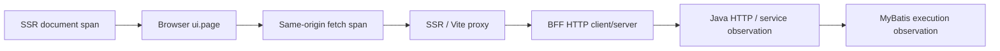

# OSS Web performance and tracing

This is the code-coupled contract for OSS home/menu/list performance instrumentation. For measured results and limits, see the [2026-10-15 evidence report](2026-10-15-oss-performance-results.md). User deployment guides remain on the documentation site.

## Request path and trace ownership



The actual development path includes the Vite HTTP proxy. Server-side application reads can also reach Java directly through the existing HTTP client configuration; their parent context is propagated by Undici instrumentation. Service names are `auraboot-web`, `auraboot-ssr`, `auraboot-bff` and `auraboot-platform`.

- `web-admin/instrumentation.server.mjs` loads before the server HTTP/fetch modules, using Node's `--import`. The SDK loads only when an OTLP trace endpoint is configured. `dev:web`, `dev:bff` and `start` include this preloader.
- The root loader injects the active W3C `traceparent` into a document meta tag. The optional browser SDK uses it as the parent of `ui.page`. React Router `.data` fetches open a `ui.navigation` span; same-origin `/api/` and `.data` fetches inject trace headers. Third-party requests are left untouched.
- Java keeps the existing W3C propagation and response `X-Trace-Id` contract. `SqlObservationInterceptor` opens `mybatis.execution` within the active observation scope for MyBatis executor query/update calls.
- `ui.page` ends at window load. It is **not** a business-data-ready metric. The home measurement script separately waits for inbox, shortcuts and numeric statistics.
- MyBatis spans contain mapper identity, operation and database system. SQL text, bind values and raw driver exception messages are not recorded by this interceptor. Its fixed failure diagnostic does not replace the exception returned to application code. SQL observation is not JDBC-wide coverage.

## Opt-in configuration

| Variable | Purpose |
| --- | --- |
| `OTEL_EXPORTER_OTLP_TRACES_ENDPOINT` | Full OTLP HTTP trace URL, e.g. `http://127.0.0.1:4318/v1/traces`; enables Node SDK and configures Java exporter |
| `MANAGEMENT_TRACING_ENABLED=true` | Enables Java tracing in dev; dev defaults to false |
| `MANAGEMENT_TRACING_SAMPLING_PROBABILITY` | Java root sampling, default `0.1`; use `1` only for controlled diagnosis |
| `OTEL_TRACES_SAMPLER=parentbased_traceidratio` | Explicit Node root sampler; SDK honors incoming sampled parents |
| `OTEL_TRACES_SAMPLER_ARG=0.1` | Node root ratio; **set this with the sampler** for bounded routine collection (Node SDK's own default is broader) |
| `VITE_OTEL_EXPORTER_OTLP_TRACES_ENDPOINT` | Browser exporter URL, exposed to the browser; must be browser-reachable and allow the exact Web origin with CORS |
| `VITE_OTEL_TRACES_SAMPLE_RATE` | Browser root ratio, default `0.1`; server parent sampling is honored |

`VITE_*` variables are build-time settings for production. Node and Java settings are runtime settings. No endpoint means the optional browser/Node exporter is not installed; Java dev tracing remains opt-in. Do not put collector credentials into `VITE_*` variables. Protect and operate the collector as deployment infrastructure. No third-party collector SaaS is required.

For a complete sampled diagnostic run, set Java and browser ratios to `1` and Node `OTEL_TRACES_SAMPLER=always_on` before invoking the product launcher. All three settings must match the recorded measurement conditions. Resume state preserves the whitelisted telemetry variables and Redis host; changing a retained source or dependency still fails identity validation.

The SDK integrations follow the upstream [browser setup](https://opentelemetry.io/docs/languages/js/getting-started/browser/) and [OTLP exporter documentation](https://opentelemetry.io/docs/languages/js/exporters/). A native collector with a [file exporter](https://github.com/open-telemetry/opentelemetry-collector-contrib/blob/main/exporter/fileexporter/README.md) is sufficient for local evidence.

## Performance behavior

- Root shell branding/bootstrap/access-policy/token reads start concurrently. Every request still resolves fresh server identity and permissions.
- Parent/child entry loaders share the `/api/auth/me` in-flight promise through the **per-request React Router context**, including cloned `Request` objects. Separate HTTP requests never share this memo; a failed promise is cleared. No global auth cache or new authorization TTL is introduced.
- `/home` fetches the workbench configuration in its route loader and renders it from loader data. The initial browser mount no longer fetches the same configuration. Widget data still uses the existing real APIs; retry remains available on configuration failure.
- Field permission evaluation resolves role codes only if model fields declare field permissions, and resolves role records in one batch. Restricted fields use the existing evaluator. Models without declarations retain the existing unrestricted policy.
- Subject permission batches without any declarations return the existing visible result without loading effective grants. Batches containing declarations still resolve permissions; this does not imply all real menus use fewer queries.
- Existing tenant and invalidation boundaries stay in place. No dynamic CRUD result cache, negative permission TTL extension or pagination/count change is introduced.

## Redis and cache boundaries

Redis is optional for this single-node OSS slice. `scripts/oss-golden-stack.sh up <name> --no-redis ...` explicitly supplies an empty Redis host, which disables the existing conditional Redis integrations. Retained resume keeps that choice. This does not switch an explicitly Redis-backed MQ/event/IM deployment into an in-memory distributed system.

The existing default Caffeine manager bounds each cache at 10,000 entries with 30-minute expiry and recorded statistics; the dedicated permission manager has its own shorter policy. Redis is appropriate only when a deployment deliberately needs its shared transport/cache semantics. Adding it does not remove repeated SQL or replace query-plan analysis. Multi-node invalidation consistency is a separate deployment acceptance requirement, not proven by the no-Redis single-node run.

Use authenticated operational metrics for `cache.gets`, `cache.size`, `cache.evictions`, `hikaricp.connections.*`, `http.server.requests` and `mybatis.execution`. Response `X-SQL-Count` counts instrumented synchronous MyBatis executor calls on the request path, not every physical PostgreSQL statement, JdbcTemplate operation or asynchronous database write.

## Reproduce measurements

Start an isolated host-first product stack with the `demo` plugin profile, warm it with canonical setup/auth, verify its source/artifact/process identity, and set `PERF_API_BASE`, `PERF_OUTPUT`, `AURABOOT_PASSWORD`. Then use the existing drivers:

```bash
node scripts/performance/seed-api.mjs
node scripts/performance/measure-api.mjs
node scripts/performance/measure-crud.mjs

# Also set PERF_SOURCE_ROOT, PERF_WEB_BASE and an absolute PERF_OUTPUT JSON path.
node scripts/performance/measure-home.mjs

# In web-admin, after evaluating the exact runtime's launcher env:
PERF_EVIDENCE_DIR="$EVIDENCE_DIR" PW_PROFILE=oss PW_WORKERS=1 \
  pnpm exec playwright test -c playwright.oss.config.ts \
  tests/e2e/showcase/oss-performance.spec.ts --project=oss --no-deps --workers=1
```

Use an empty showcase model for seed: the driver refuses to overwrite existing data and creates exactly 1,000 controlled records. Reads require exactly 1,000 total/20 page rows and an SQL-count header. The CRUD driver creates, edits, reads back and deletes its own records, and requires a 404 after deletion. Failures stop the run; no partial file marked `running` is a completed result.

The home driver requires an empty inbox, visible shortcut rows and pending/urgent counts of zero in the controlled fixture. It excludes the first warmup and records ten subsequent navigations, raw timings, browser API paths and document trace context. Use the **same driver**, data, viewport, locale, collector and sampling conditions against immutable before/after sources. Run sequentially without concurrent build/test traffic. Dev-mode measurements are diagnostics; production cold loads, Web Vitals and concurrency capacity require separate evidence.

## Code and evidence map

| Concern | Source |
| --- | --- |
| Home configuration and shell loading | `web-admin/app/root.tsx`, `app/plugins/core-dashboard/pages/home/index.tsx` |
| Per-request identity memo | `web-admin/app/shared/services/userService.ts` |
| Browser and server SDKs | `web-admin/app/shared/observability/browserTracing.ts`, `web-admin/instrumentation.server.mjs` |
| SQL observation | `platform/.../observability/SqlObservationInterceptor.java` |
| Lazy/batched field grants | `platform/.../permission/service/impl/FieldPermissionServiceImpl.java` |
| Subject batches | `platform/.../permission/evaluator/SubjectPermissionEvaluator.java` |
| Redis and local caches | `platform/.../application/config/RedisOptionalConfig.java`, `CacheConfig.java` |
| Reproducible workloads | `scripts/performance/` |
| Real UI transitions | `web-admin/tests/e2e/showcase/oss-performance.spec.ts` |
| Raw samples, linked trace and screenshots | [2026-10-15 evidence](2026-10-15-oss-performance-results.md) |
